# Data Analyst AI Agent

[](https://github.com/shreyescodes/Data-Analyst-AI-Agent/actions/workflows/ci.yml)


[](LICENSE)

Load a CSV, Excel file, API response or database table; clean it with a
transparent, reportable pipeline; ask questions in plain English or SQL; and
explore it with charts and a full profiling report. Everything runs in one
Streamlit app.

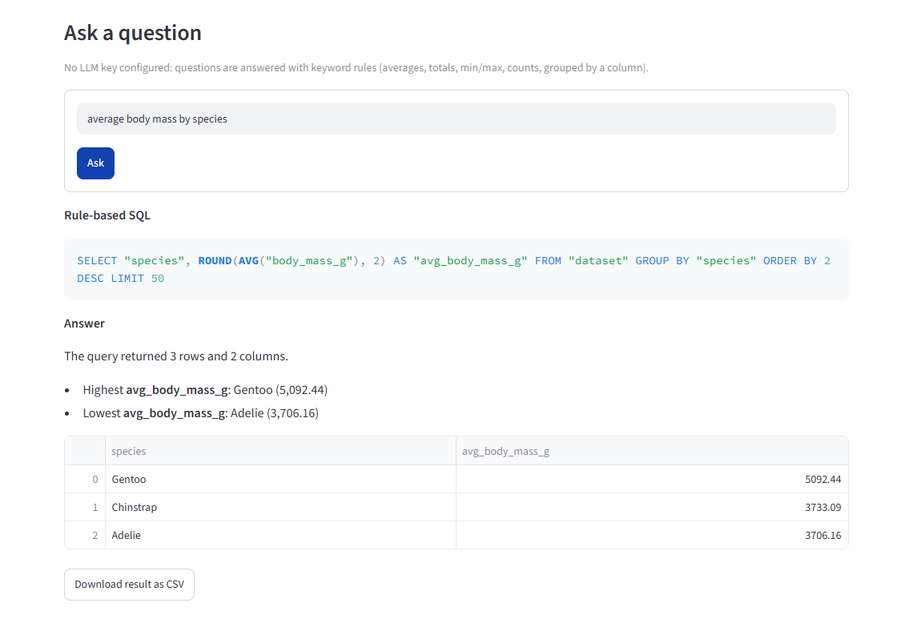

## Problem

Analysts spend much of their time on mechanical work: fixing whitespace and
types, dropping duplicates, writing the same `GROUP BY` queries, and building
one-off charts. People without SQL skills often cannot get answers from raw
data at all without help from an engineer.

## Solution

A single workflow that takes a raw file to answers:

1. **Load** from a file upload, an HTTP API, or a SQL database.
2. **Clean** with explicit, ordered steps. Every step reports what it changed,
   and no step silently loses data.
3. **Ask** questions in English. They are translated to SQL (by an LLM if one
   is configured, otherwise by keyword rules), run read-only, and summarised.
4. **Visualise** from a plain-English request, or take a quick look at
   correlations and distributions.
5. **Profile** the dataset with a full HTML report, and **snapshot** versions
   you can restore.

## Demo on a real dataset

All screenshots below were captured automatically from the running app by
[`scripts/capture_screenshots.py`](scripts/capture_screenshots.py), using the
[Palmer Penguins](https://allisonhorst.github.io/palmerpenguins/) dataset
(344 real penguins, CC0; a copy is in [`docs/data/penguins.csv`](docs/data/penguins.csv)).
They show the app's **rule-based mode** (no LLM key). Run `make screenshots`
to regenerate them.

**1. Load.** The upload is parsed and previewed; the raw data has missing measurements and sexes.

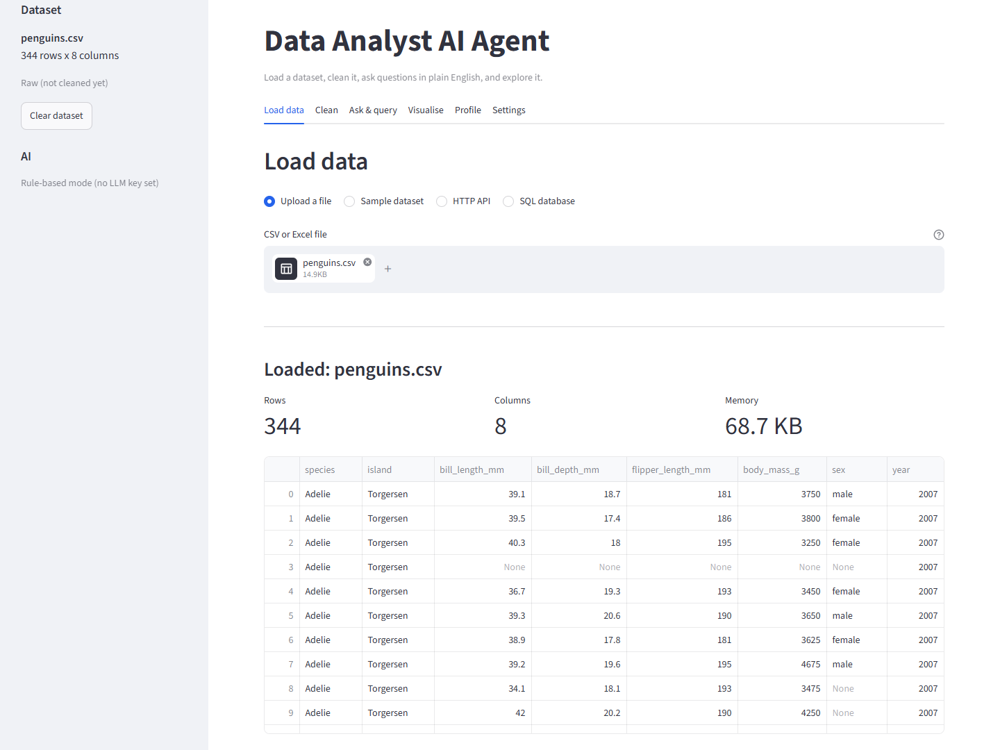

**2. Clean.** The quality summary finds 19 missing cells. The pipeline reports each step: here 11 incomplete rows are dropped, leaving 333.

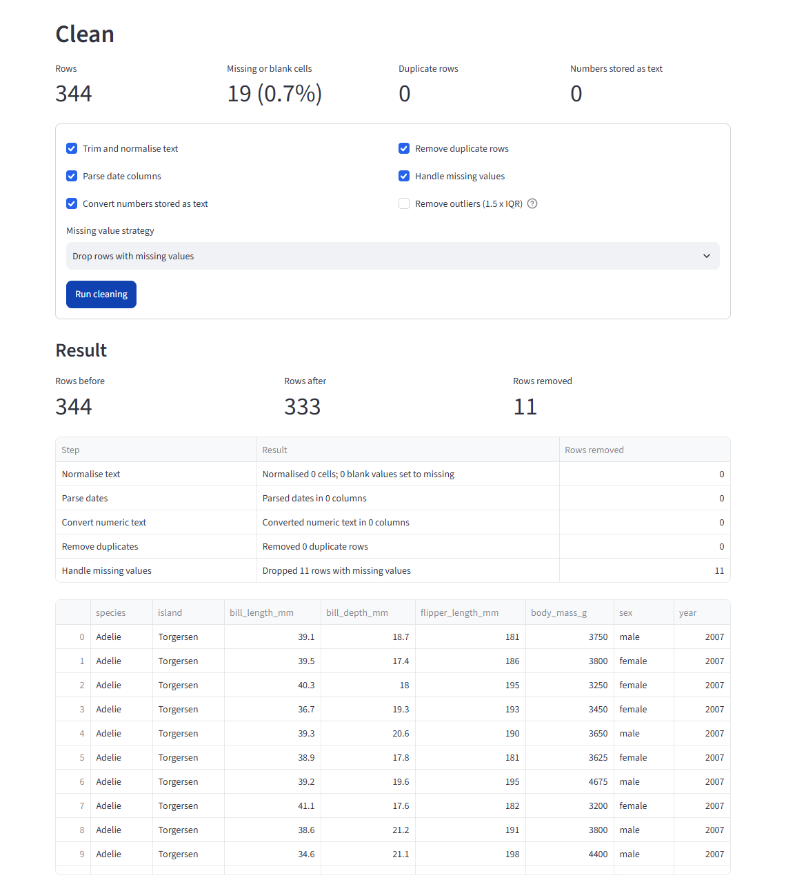

**3. Snapshot.** The cleaned data is saved as an immutable, checksummed Parquet snapshot.

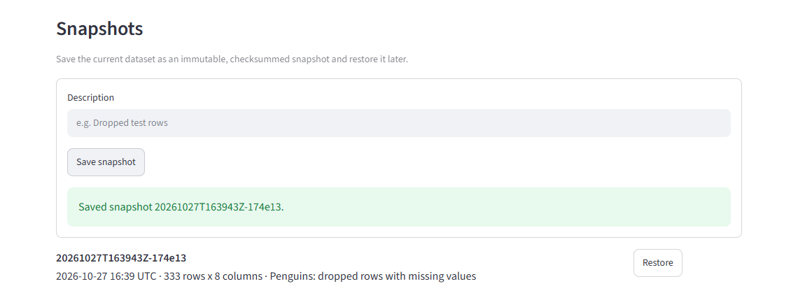

**4. Ask in plain English.** "average body mass by species" becomes SQL, runs, and is summarised (shown at the top of this page).

**5. Write SQL.** Results can be downloaded as CSV.

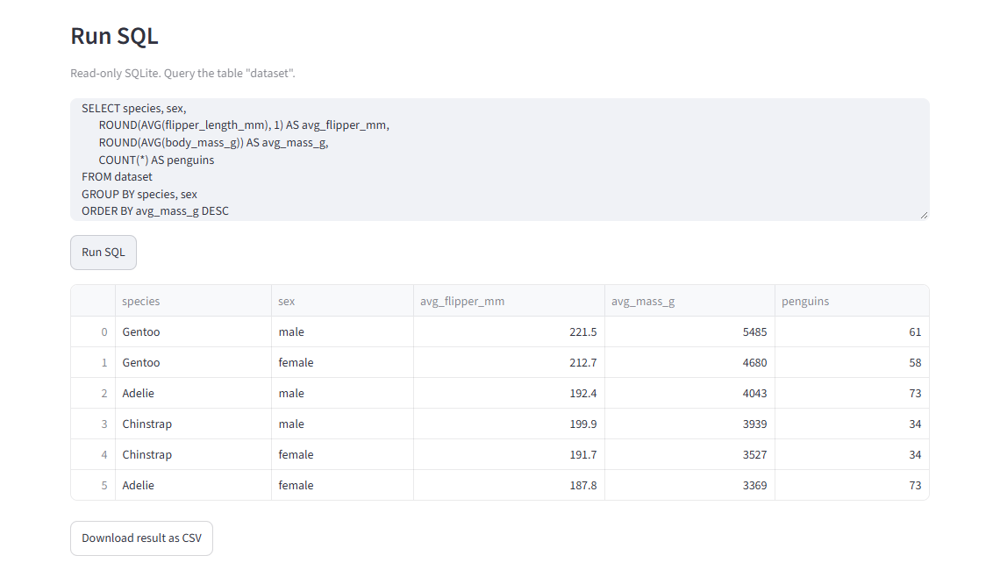

**6. Writes are impossible.** Queries run on a read-only connection, so this `DELETE` is refused.

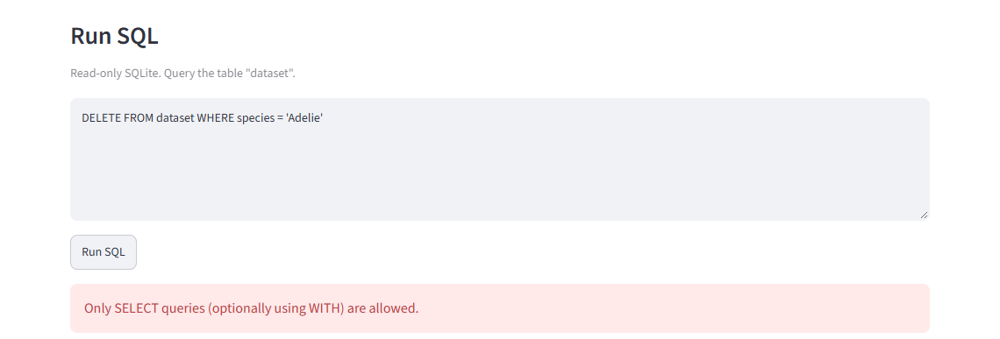

**7. Charts from a description.** "body mass vs flipper length" picks a scatter plot, the two mentioned columns, and colours by species.

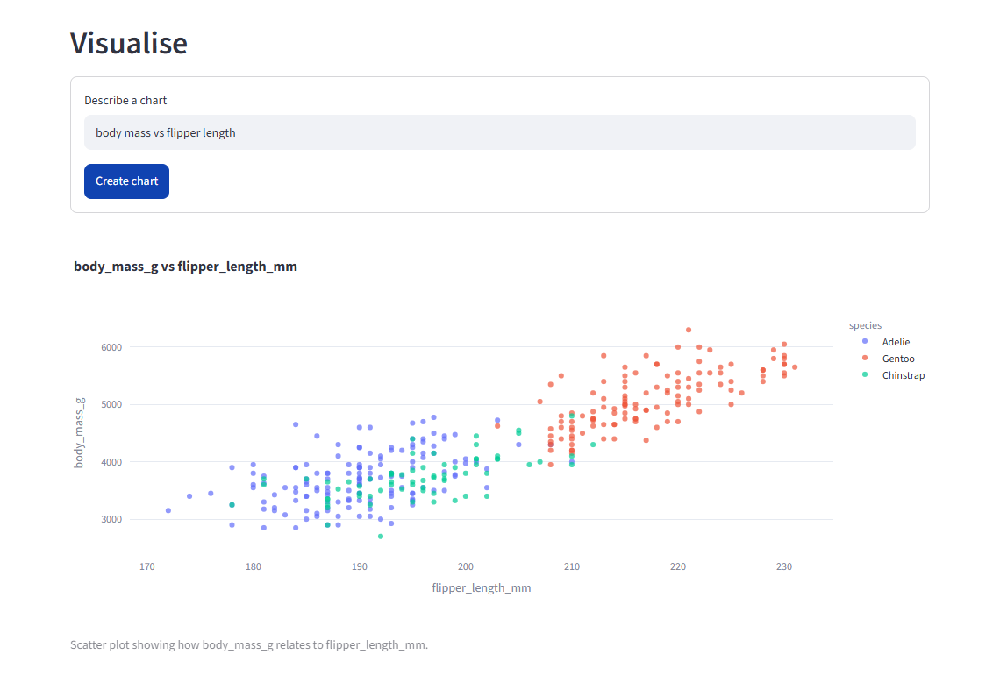

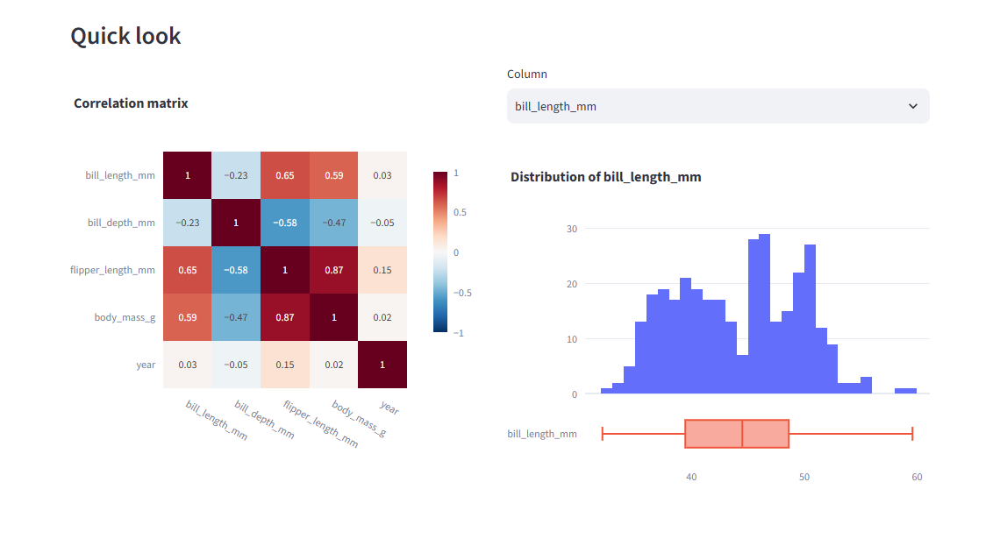

**8. Profiling report.** A full report built with fg-data-profiling, viewable inline or downloadable as HTML.

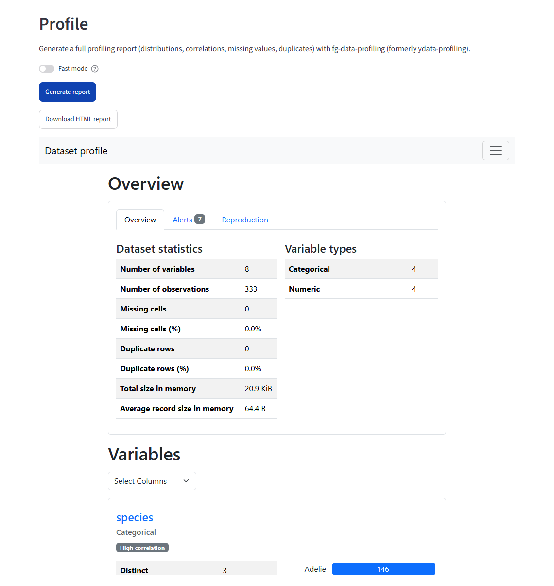

## Main features

| Area | What it does |
|---|---|
| Ingestion | CSV (UTF-8 with BOM, Latin-1 fallback) and XLSX upload; JSON/CSV HTTP APIs, with common envelopes (`data`, `results`, ...) unwrapped and nested fields flattened; any SQLAlchemy database (SQLite built in, PostgreSQL and MySQL via extras). |
| Cleaning | Normalise whitespace (blank strings become missing), parse date columns, convert numbers stored as text, remove duplicates, handle missing values (6 strategies), optionally remove IQR outliers. A column is only re-typed when **every** value converts. |
| Querying | English to SQL by an LLM, or by keyword rules (averages, totals, min/max, counts, each optionally grouped by a column). Hand-written SQL in an editor that is pre-filled with the generated query. |
| Safety | Read-only SQLite connection, row cap, query timeout, SSRF guard on the API loader, upload size limit. |
| Visualisation | Line, bar, scatter, histogram, box and pie charts chosen from a request; correlation heatmap; distribution plot. |
| Profiling | Full or minimal HTML report; fast mode switches on automatically for large datasets. |
| Versioning | Parquet snapshots with SHA-256 integrity checks; types survive a round trip. |

## Architecture

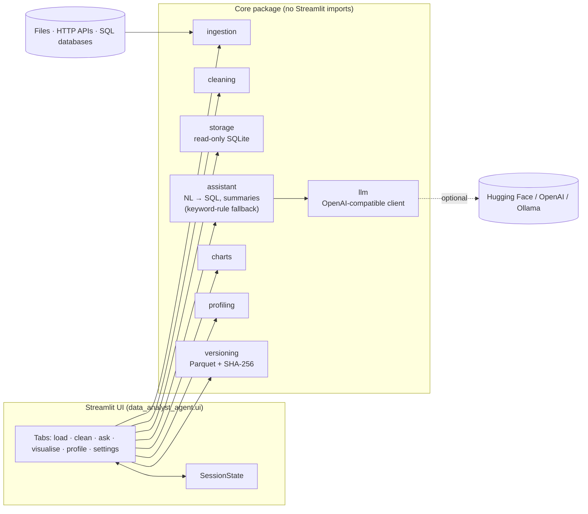

How a question is answered:

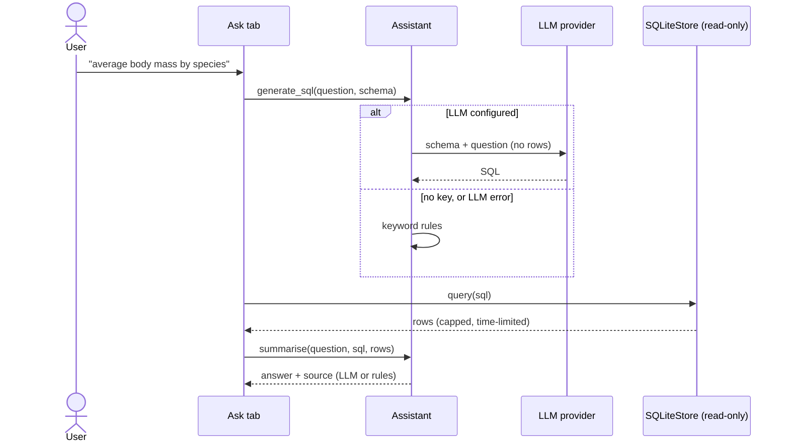

Key design decisions are recorded as ADRs in [`docs/decisions/`](docs/decisions/):
[read-only SQL execution](docs/decisions/0001-read-only-sqlite-for-untrusted-sql.md),
[pluggable LLM with fallback](docs/decisions/0002-openai-compatible-llm-with-rule-based-fallback.md),
and [the core/UI split](docs/decisions/0003-framework-free-core-with-thin-streamlit-ui.md).

## Tech stack

- **Python 3.11+**, **pandas**, **NumPy**
- **Streamlit** for the UI
- **SQLite** (standard library) for the query sandbox; **SQLAlchemy** for reading external databases
- **Plotly** for charts; **fg-data-profiling** (successor to ydata-profiling) for reports
- **PyArrow / Parquet** for snapshots
- **requests**: any OpenAI-compatible chat-completions API (default: Hugging Face Inference Providers)
- **uv** (lock file), **ruff**, **mypy --strict**, **pytest**, **pre-commit**, **GitHub Actions**, **Docker**

## Dataset

The app works on user-provided data. Two datasets ship with the repo:

- [`docs/data/penguins.csv`](docs/data/penguins.csv): Palmer Penguins (real measurements, CC0), used for the screenshots.
- `src/data_analyst_agent/data/sample_sales.csv`: a synthetic, deliberately messy sales file (stray whitespace, blank cells, duplicates, numbers stored as text). Load it from **Load data → Sample dataset** to see every cleaning step do something.

Data stays on the machine running the app, except what is sent to the LLM
provider when one is configured (see [Security](#security)).

## Evaluation

- **Automated tests:** 193 tests (`pytest`), ~90% branch coverage, enforced at ≥85% in CI. They include:
  - regression tests for each bug fixed in the rewrite (for example `NaN` becoming the string `"nan"`, outlier removal dropping rows with missing values, broken chart type inference);
  - security tests proving writes, multi-statement injection and runaway queries are refused, and that private-network URLs are blocked;
  - end-to-end tests that drive the real Streamlit app (load → clean → ask → snapshot) with `streamlit.testing.v1.AppTest`.
- **Live LLM tests** (`pytest -m live`, opt-in with `RUN_LIVE_LLM_TESTS=1`) check that a real model produces SQL that runs and returns the right rows.

### Natural-language-to-SQL accuracy

[`evals/nl_to_sql_penguins.json`](evals/nl_to_sql_penguins.json) holds 20 questions about the raw
penguins table, each with hand-written reference SQL. They cover aggregates, grouping, filters,
`NULL` handling, ranking and `DISTINCT`. [`scripts/evaluate_nl_to_sql.py`](scripts/evaluate_nl_to_sql.py)
runs the generated and the reference query and scores **execution accuracy**: a question passes when
both return the same rows, ignoring column names, column and row order, and float noise.

| Mode | Execution accuracy | Median time per question |
|---|---:|---:|
| Keyword rules (no LLM) | 8 / 20 (40%) | < 0.01 s |

The rules handle aggregates and single-column grouping. They fail on filters ("female", "on Dream
island"), rankings and `DISTINCT`, which is where an LLM is needed. Reproduce with `make eval`
(add `LLM_*` variables to evaluate a model).

## Installation

### Docker

```bash
cp .env.example .env    # optional: configure an LLM
docker compose up --build
```

To use a model running on the host (Ollama, LM Studio, llama.cpp), set
`LLM_BASE_URL=http://host.docker.internal:<port>/v1` in `.env`.

Open http://localhost:8501. Snapshots persist in the `versions` volume. The
image is a multi-stage build that runs as a non-root user with a health check;
CI builds it and checks the health endpoint on every push.

### Local with uv (recommended)

```bash
uv sync                      # creates .venv from uv.lock
uv run streamlit run app.py
```

### With a local model (no API key)

Any OpenAI-compatible local server works, and nothing leaves your machine:

| Server | Start it | Then set |
|---|---|---|
| [Ollama](https://ollama.com) | `ollama pull qwen2.5-coder:3b` | `LLM_BASE_URL=http://localhost:11434/v1` `LLM_MODEL=qwen2.5-coder:3b` |
| [LM Studio](https://lmstudio.ai) | load a model, start the server | `LLM_BASE_URL=http://localhost:1234/v1` `LLM_MODEL=<model id>` |
| [llama.cpp](https://github.com/ggml-org/llama.cpp) | `llama-server -m model.gguf --port 8080` | `LLM_BASE_URL=http://localhost:8080/v1` `LLM_MODEL=<any name>` |

Setting `LLM_BASE_URL` to anything other than the hosted default turns the AI features on;
`LLM_API_KEY` is only needed for hosted providers. Small code-tuned models (Qwen2.5-Coder 1.5B
to 7B) run on a laptop CPU.

### Local with pip

```bash
python -m venv .venv && source .venv/bin/activate   # Windows: .venv\Scripts\activate
pip install -e .
streamlit run app.py
```

Optional database drivers: `pip install -e ".[postgres]"` or `".[mysql]"`.

## Configuration

All settings are environment variables (see [`.env.example`](.env.example)); all are optional.

| Variable | Default | Purpose |
|---|---|---|
| `LLM_API_KEY` | unset | Key for hosted providers; enables the default Hugging Face endpoint. `HF_TOKEN` / `HF_API_KEY` are also accepted. Not needed for local servers. |
| `LLM_BASE_URL` | `https://router.huggingface.co/v1` | Any OpenAI-compatible endpoint. Setting a non-default URL (such as a local Ollama server) enables AI features without a key. |
| `LLM_MODEL` | `meta-llama/Llama-3.3-70B-Instruct` | Model id for the endpoint. |
| `LLM_TIMEOUT_SECONDS` | `30` | Per-request timeout (requests are retried on 429/5xx). |
| `MAX_UPLOAD_MB` | `100` | Upload size limit (also set in `.streamlit/config.toml`). |
| `QUERY_ROW_LIMIT` | `10000` | Maximum rows returned by a query. |
| `QUERY_TIMEOUT_SECONDS` | `10` | Queries running longer are interrupted. |
| `ALLOW_PRIVATE_URLS` | `false` | Let the API loader reach private and loopback hosts (local use only). |
| `DATA_VERSIONS_DIR` | `data_versions` | Where snapshots are stored. |
| `LOG_LEVEL` | `INFO` | Python logging level. |

## Security

- **SQL:** queries from users and the LLM run on a SQLite connection opened in read-only mode with `query_only`, with a row cap and a timeout. Rationale in [ADR-0001](docs/decisions/0001-read-only-sqlite-for-untrusted-sql.md).
- **LLM data exposure:** generating SQL sends only column names and types. Summaries send at most 50 result rows. With a local model, or with no LLM, nothing leaves the machine.
- **SSRF:** the HTTP API loader refuses hosts that resolve to private, loopback, link-local or reserved addresses (including the cloud metadata IP), and does not follow redirects.
- **Uploads:** file type allowlist and size limit; database table names are resolved by reflection, never interpolated into SQL.
- **Snapshots:** version ids are validated against a strict pattern (no path traversal), and data files are verified by SHA-256 on load.
- **Container:** non-root user, no build tools in the runtime image, secrets via `.env` (git-ignored).

## Cost and performance

Measured on a laptop (8-thread Intel CPU) with a synthetic 5-column dataset:

| Rows | Clean (all default steps) | Load into query store | Grouped query |
|---:|---:|---:|---:|
| 10,000 | 0.07 s | 0.07 s | 12 ms |
| 100,000 | 0.6 s | 0.5 s | 57 ms |
| 1,000,000 | 6.1 s | 3.9 s | 0.57 s |

- A full profiling report on the penguins data (333 × 8) takes about 9 s; fast mode is enabled automatically above 2 million cells.
- With an LLM, each question makes two calls (SQL ≤ 400 output tokens, summary ≤ 500). Cost depends on the provider; Hugging Face includes monthly free credits.
- Data is held in memory, so the practical limit is a few million rows per session.

## Development

```bash
make install     # uv sync + pre-commit hooks
make check       # ruff, mypy --strict, pytest with coverage (what CI runs)
make test-fast   # skip slow tests
make run
make eval        # NL-to-SQL accuracy (rules, or the LLM configured in the environment)
make screenshots # regenerate README images (needs Chrome)
```

CI ([`.github/workflows/ci.yml`](.github/workflows/ci.yml)) runs lint and
type-checking, the test suite on Python 3.11 and 3.12, then builds the Docker
image and waits for its health check. Dependabot keeps the lock file, the
Docker base image and the Actions up to date. See [CONTRIBUTING.md](CONTRIBUTING.md).

### Project structure

```text
├── app.py                       # Streamlit entry point
├── src/data_analyst_agent/
│   ├── config.py                # Settings from environment variables
│   ├── exceptions.py            # DataAgentError hierarchy
│   ├── ingestion.py             # Files, HTTP APIs, SQL databases
│   ├── cleaning.py              # Quality assessment + cleaning pipeline
│   ├── storage.py               # Read-only SQLite query store
│   ├── assistant.py             # NL → SQL and summaries, with fallbacks
│   ├── llm.py                   # OpenAI-compatible chat client
│   ├── schema.py                # Column classification and matching
│   ├── charts.py                # Chart suggestion and rendering
│   ├── profiling.py             # HTML profiling reports
│   ├── versioning.py            # Checksummed Parquet snapshots
│   ├── data/sample_sales.csv
│   └── ui/                      # Streamlit layer (state, resources, one view per tab)
├── tests/                       # Unit, security and end-to-end tests
├── evals/                       # NL-to-SQL evaluation questions + reference SQL
├── scripts/                     # Screenshot capture, evaluation runner
└── docs/                        # ADRs, screenshots, demo dataset
```

## Limitations

- Rule-based mode understands a fixed set of question shapes (one aggregate, optionally grouped by one column). Anything more complex needs an LLM key or hand-written SQL.
- LLM-generated SQL can be wrong. The generated query is always shown and editable, but answers should be checked.
- Data lives in memory per browser session; very large datasets (tens of millions of rows) need a different backend.
- IQR outlier removal is generic: on columns with a few discrete values (for example price tiers) it can remove legitimate rows. It is off by default.
- No authentication or multi-user access control; deploy behind an authenticating proxy if exposed.

## Future improvements

- Run the evaluation in CI against a small local model, and grow the question set beyond one dataset.
- Per-column cleaning options (choose which columns each step touches).
- DuckDB backend for larger datasets (see ADR-0001).
- Scheduled pipelines and report export.

## License

[MIT](LICENSE)
